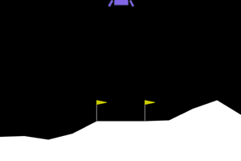

# RL Robotics Journey

My 3-month self-study of reinforcement learning for robotics — from tabular Q-learning to PPO, heading toward robot manipulation in MuJoCo and a real low-cost arm.



## Progress

| Week | Topic | Result |
|------|-------|--------|
| 1 | Random agent on CartPole | baseline: 21 steps |
| 2 | Tabular Q-learning from scratch on FrozenLake | 100% (deterministic), 74% (slippery — near the theoretical ceiling) |
| 3 | PPO on LunarLander (Stable-Baselines3) | **212.4 ± 74.0** — solved (threshold 200) |

## Experiment: how the discount factor γ changes behaviour

PPO on LunarLander-v3, 300k steps (shorter than the main run), 3 seeds per setting. Hypothesis written before running.

| γ | Horizon 1/(1−γ) | Mean return | Min | Max | Behaviour |
|---|---|---|---|---|---|
| 0.999 | 1000 | 102.4 | −42.1 | 192.2 | lands (~650 steps) |
| 0.99 | 100 | 5.2 | −128.6 | 183.3 | unstable — depends on the seed |
| 0.9 | 10 | −136.0 | −167.5 | −103.8 | hovers until the time limit |


**Takeaway.** The higher γ, the more it pays off for the agent to land; with low γ it prefers to hover and never risks a crash. The fuel burned while hovering is spread over hundreds of steps, so with γ = 0.9 the agent perceives the cost of hovering *forever* as only ~1.7 points — while a crash (−100) is right in front of it.

The difference between γ = 0.999 and γ = 0.99 is within seed-to-seed variance; only γ = 0.9 is clearly worse.

## Run it

```bash
uv sync
uv run python experiments/week03/ppo_lunar.py
uv run python experiments/week03/watch.py runs/week03_ppo_lunar/ppo_lunar
```

## Repository layout

```
experiments/   one-off scripts, grouped by week
notes/         notes and analogies (in Polish)
src/           reusable code (custom environment coming in week 8)
media/         GIFs for this README
JOURNAL.md     learning log (in Polish)
```

### Week 5 — What makes tuned PPO work on HalfCheetah?

Same algorithm (PPO), same budget (1M steps), seed 0, same 50 evaluation episodes.
"Weak" = episode return < 1000.

| Variant | Mean of good runs | Weak runs |
|---|---|---|
| SB3 defaults | 1585 | 0% |
| + obs/reward normalization only | 1730 | 0% |
| + log_std_init = -2 only | 1385 | 42% (slow walking, no flips) |
| + both | 4567 | 0% |
| Full RL Zoo config (10 changes) | 6465 | 30% (flips onto its back) |

Takeaways:
- Each setting alone barely helps (or hurts); together they triple the score. An interaction, not a sum.
- The full Zoo config runs faster but flips in ~1/3 of episodes; the two-setting version never flipped. Speed vs. reliability.
- 10 evaluation episodes overestimated the Zoo model (5385 vs 4699 on 50). Single seed per variant, so results are preliminary.

### Week 5 — What makes tuned PPO work on HalfCheetah? (corrected in week 6)

Same algorithm (PPO), same budget (1M steps), seed 0, same 50 evaluation episodes.
Posture is measured directly from the torso angle (added in week 6), not guessed from the score.

| Variant | Mean return | On its back | Other failures |
|---|---|---|---|
| SB3 defaults | 1585 | 100% | — |
| + obs/reward normalization only | 1730 | ?% | ? |
| + log_std_init = -2 only | 1094 | 24% | 13 slow episodes |
| + both | 4567 | 0% | — |
| Full RL Zoo config (10 changes) | 4699 | 0% | 30% stuck tilted ~50° |

**Correction:** in week 5 I reported that the default policy "never flips" and the Zoo policy
"flips onto its back". Both were wrong. A flip detector showed that the default policy runs
on its back in every episode, and that the Zoo failures are the cheetah getting stuck tilted
~50°, not lying on its back. A stable score (1585 ± 61) said nothing about posture.

### Week 6 — Fixing the back-running cheetah with reward shaping

The HalfCheetah reward pays only for forward speed, so running on its back is a valid
solution (specification gaming). I added a posture penalty during training only:
`weight * (cos(torso_angle) - 1)`, which is 0 when level and −2 when upside down.
Evaluation uses the original reward.

| SB3 default PPO, 1M steps, seed 0 | Mean return (original reward) | On its back |
|---|---|---|
| no penalty (control) | 1585 | 100% |
| posture penalty, weight 1 | 2764 | 0% |
| + obs/reward normalization only | 1730 | 100% | — |

The penalty did more than forbid a behavior: it pushed the agent out of a local optimum.
Upright running scores 74% higher even on the original reward. Single seed, so preliminary.

### Week 5 — What makes tuned PPO work on HalfCheetah? (corrected in week 6)

Same algorithm (PPO), same budget (1M steps), seed 0, same 50 evaluation episodes.
Posture is measured directly from the torso angle (added in week 6), not guessed from the score.

| Variant | Mean return | On its back | Other failures |
|---|---|---|---|
| SB3 defaults | 1585 | 100% | — |
| + obs/reward normalization only | 1730 | 100% | — |
| + log_std_init = -2 only | 1094 | 24% | 13 slow episodes |
| + both | 4567 | 0% | — |
| Full RL Zoo config (10 changes) | 4699 | 0% | 30% stuck tilted ~50° |

**Correction:** in week 5 I reported that the default policy "never flips" and the Zoo policy
"flips onto its back". Both were wrong. A flip detector showed that the default policy runs
on its back in every episode, and that the Zoo failures are the cheetah getting stuck tilted
~50°, not lying on its back. A stable score (1585 ± 61) said nothing about posture.

### Week 6 — Fixing the back-running cheetah with reward shaping

The HalfCheetah reward pays only for forward speed, so running on its back is a valid
solution (specification gaming). I added a posture penalty during training only:
`weight * (cos(torso_angle) - 1)`, which is 0 when level and −2 when upside down.
Evaluation uses the original reward.

| SB3 default PPO, 1M steps, seed 0 | Mean return (original reward) | On its back |
|---|---|---|
| no penalty (control) | 1585 | 100% |
| posture penalty, weight 1 | 2764 | 0% |

The penalty did more than forbid a behavior: it pushed the agent out of a local optimum.
Upright running scores 74% higher even on the original reward. Single seed, so preliminary.
The new gait still pitches the torso a lot (up to ~70°, vs ~20° for the Zoo policy).

#### Smoothness penalty (action-rate penalty)

Added on top of the posture penalty during training: `smooth * sum((a_t - a_{t-1})^2)` over the 6 joints.
Jerk = mean |a_t − a_{t−1}| per joint (0 = smooth, 2 = jumping between −1 and +1 every step).
Return over 50 episodes; jerk and saturation over 10 episodes.

| smooth | Mean return | Jerk | Saturated actions | On its back | Final policy std |
|---|---|---|---|---|---|
| 0 | 2764 | 0.853 | 44% | 0% | 0.22 |
| 0.1 | 1383 | 0.575 | 32% | 44% | 0.21 |
| 0.3 | 1728 | 0.459 | 14% | 4% | 0.13 |
| reference: normalization + log_std_init = -2, no penalties | 4567 | 0.499 | 8% | 0% | — |

The penalty reduced jerk, but at a large cost in speed. At smooth = 0.3 the exploration noise collapsed much faster:
penalizing action changes also penalizes random exploration. The smoothest *and* fastest policy came from fixing
the cause (small initial std + normalization), not from penalizing the symptom.
Single seed; the 44% flips at smooth = 0.1 are not explained yet.